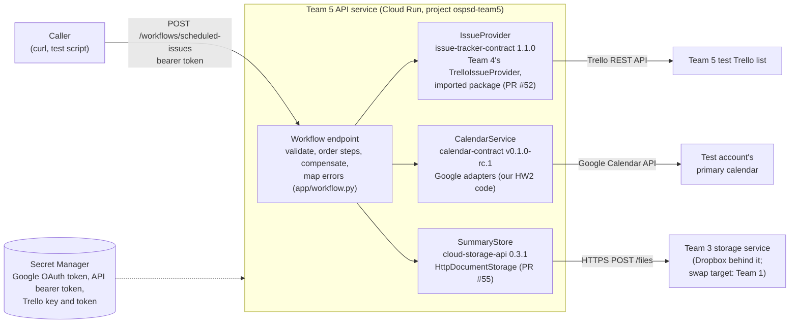

# Team 5: composing Calendar, issue tracker, and storage

| Item | Value |
| --- | --- |
| Status | **Draft for team and outside-team review.** Endpoint in [PR #53](https://github.com/juno-junhyuk-lee/OSPSD-Team-5/pull/53), issue adapter in [PR #52](https://github.com/juno-junhyuk-lee/OSPSD-Team-5/pull/52), Calendar selection in [PR #54](https://github.com/juno-junhyuk-lee/OSPSD-Team-5/pull/54) (merged), storage adapter in [PR #55](https://github.com/juno-junhyuk-lee/OSPSD-Team-5/pull/55); deployment not started. Behavior below describes those PRs as of 2026-11-15. Per-vertical detail (arriving with #52, #53 and #55) lives in [WORKFLOW.md](docs/WORKFLOW.md), [ISSUE_TRACKER_INTEGRATION.md](docs/ISSUE_TRACKER_INTEGRATION.md), [HW3_CALENDAR_HANDOFF.md](docs/HW3_CALENDAR_HANDOFF.md) and [HW3_STORAGE.md](docs/HW3_STORAGE.md); this document holds the combined design and links to them instead of repeating them. |
| Milestone | HW3 Milestone 1, "Compose the Services", due November 18, 2026, before class |
| Owner | Member 5 (Ka Pui) coordinates; each section names the member who owns the code |
| Previous design | HW2 shared Calendar adoption: [docs/HW2_DESIGN.md](docs/HW2_DESIGN.md) |

## Goal and scope

One API operation turns a task into a tracked, scheduled, documented piece of work. A caller sends a title and a time slot. The service creates an issue, books a calendar event with the same title, writes a Markdown summary that links both, stores the summary, and returns all three references in one result.

The handout requires fixed steps with no language model, our own implementation for our vertical (Calendar), another team's implementation for each of the other two, configuration-only implementation swapping, failures reported in our HW1 error model with the failed step, deployment through our HW2 pipeline, and one test account with credentials outside the repository.

Not in scope for this milestone: a language model, an interface, more than one user, or more than this one scenario. Milestone 2 extends this document with the product, interface, agent, and real-user security.

**Why this workflow.** Each step writes to a different vertical and depends on the one before it: the summary needs both IDs. That makes every partial failure the handout asks about reachable, and the result is easy to check directly in each provider.

**Which steps need judgment later.** Today the caller supplies the title and time slot. In Milestone 2 an agent can choose those (what to call the task, which free slot to book, what the summary says). Validation, write order, compensation and error reporting stay fixed code, because they protect provider state.

**If another team's service is unavailable.** The operation fails before or at that step with a documented error, and nothing is faked or replaced silently. For a longer outage we switch to another team's implementation through configuration (the same mechanism as the planned storage swap) and tell the owning team.

## How the system fits together



All three verticals run inside one FastAPI application. Separate boxes are separate contract boundaries, not separate services.

| Vertical | Shared contract | Implementation | Selected by | Owner |
| --- | --- | --- | --- | --- |
| Calendar | `calendar-contract` tag `v0.1.0-rc.1` (`1c1cad7`) | Team 5 Google adapters | `CALENDAR_IMPLEMENTATION=google` (PR #54) | Member 2 (Jim) |
| Issue tracker | `issue-tracker-contract` tag `issue-tracker-contract-v1.1.0` (`18fb7ae`) | Team 4's `team-4-issue-tracker-trello` package, tag `team-4-issue-tracker-trello-v1.0.0` (`c88ce2f`), run in our process against our Trello list | `ISSUE_TRACKER_IMPLEMENTATION=team4_trello` (PR #52) | Member 3 (Juno) |
| Cloud storage | `cloud-storage-api` tag `0.3.1` (`664afc9`) | Team 3's hosted service over HTTP; swap to Team 1 | `STORAGE_BASE_URL`, `STORAGE_ROOT_PATH` (PR #55) | Member 4 (Kristie) |
| Composition | none (our endpoint) | `app/workflow.py` | not configurable | Member 1 (Niriti) |

Credentials never enter the repository. Locally they come from git-ignored files and environment variables. In the deployment they come from Secret Manager through the HW2 Terraform configuration. The issue tracker needs our Trello key, token and list ID (`TRELLO_API_KEY`, `TRELLO_TOKEN`, `TRELLO_LIST_ID`), kept locally in ignored `.env.trello`. Team 3's test storage service needs no caller token; `STORAGE_BEARER_TOKEN` exists for a service that does, and Dropbox credentials stay with Team 3.

### A request traced end to end

```http
POST /workflows/scheduled-issues
Authorization: Bearer <from Secret Manager>
Content-Type: application/json

{"title": "Fix login bug", "start": "2030-01-07T15:00:00Z", "end": "2030-01-07T15:30:00Z"}
```

The `step` column is the value an error reports. IDs below are illustrative until the first deployed run replaces them with real output.

| `step` | Call | Intermediate state |
| --- | --- | --- |
| `validate` | none; checks the title against both contracts (issue: 1 to 256 characters with a non-space; Calendar: not blank) and the times against the Calendar contract's start/end rules | nothing written |
| `issue` | `IssueProvider.create_issue(title)` → Team 4's package → Trello (one attempt; timeout fixed by the package) | issue `T4-123` exists |
| `event` | `CalendarService.create(CreateEvent(title, start, end))` → Google | event `abc123` exists |
| `summary` | `render_summary(issue, event)` (pure function: Markdown from provider-confirmed values, titles escaped, IDs in code spans), then `SummaryStore.save_summary(name, markdown)` → Team 3 | file `scheduled-issue-T4-123-abc123.md` exists |

The summary name comes from the issue and event IDs (`summary_name` in `app/workflow.py`), so it is unique per attempt and can be found again from the IDs in `leftovers`.

Success is `201`:

```json
{
  "issue": {"id": "T4-123", "title": "Fix login bug"},
  "event": {"id": "abc123", "title": "Fix login bug", "start": "2030-01-07T15:00:00Z", "end": "2030-01-07T15:30:00Z"},
  "summary": {"id": "scheduled-issue-T4-123-abc123.md", "markdown": "# Fix login bug\n…"}
}
```

If storage definitely fails, the service deletes the event, then the issue, and returns:

```json
{
  "error": {
    "code": "provider_error",
    "message": "The summary could not be stored.",
    "retryable": true,
    "step": "summary",
    "leftovers": []
  }
}
```

## Decisions with the largest effect

### 1. Depend only on the shared contracts; choose each implementation by a setting

- **Constraint:** we must use another team's implementation for two verticals, and swapping teams must need no code change.
- **Approach:** the endpoint depends only on contract types (`IssueProvider`, `CalendarService`, `SummaryStore` over `DocumentStorage`). A dependency factory reads a setting and returns the implementation. The two other-team verticals currently reach their implementations in different ways:
  - **Issue tracker:** we import Team 4's package and run it against our own Trello list (PR #52). This follows Tyler's November 15 clarification of the TA's expectation, and replaced an earlier HTTP adapter that could not pass `fresh=True` through Team 4's cached API.
  - **Storage:** we call Team 3's hosted service through an HTTP adapter for `cloud-storage-api` (PR #55), so the swap to Team 1 is a URL change.
- **Alternative:** one approach for both. Importing storage too would put Dropbox credentials in our project; calling Team 4 over HTTP brings back the cache problem.
- **Tradeoff:** importing means we own Trello credentials and inherit the package's fixed timeout; HTTP adds a network hop and depends on the other team's hosting. Two approaches also mean two kinds of setting and swap to explain.
- **Revisit when:** staff confirm whether HTTP use of another team's hosted service counts as "using their implementation" (open question 1); if not, storage moves to an imported package as well.

### 2. Never retry a write; undo only after a definite failure; report what may remain

- **Constraint:** the Calendar and issue-tracker contracts both report an uncertain write as a non-retryable `provider_error` and forbid retrying it; we apply the same rule to storage. No vertical gives us an idempotency key we have verified.
- **Approach:** each write runs once. If a later step *definitely* did nothing, earlier writes are deleted newest first (a `not_found` during cleanup counts as removed). If a write's outcome is *uncertain*, nothing is deleted. The error lists every resource that may still exist (`leftovers`, each `created` or `uncertain`). `retryable` is true only when the failed step allows a retry **and** nothing from this attempt remains.
- **Alternative:** retry with idempotency keys (Team 4's package has tagged-creation helpers we leave disabled), or a saga that records state and finishes later.
- **Tradeoff:** an uncertain failure needs a person to reconcile, guided by `leftovers`. In return, the service never creates duplicates and never claims unfinished work succeeded.
- **Revisit when:** all three implementations offer idempotency we can verify across restarts.

### 3. One title for issue and event; the summary uses provider-confirmed values

- **Constraint:** the summary must link the real records, and the two contracts limit titles differently.
- **Approach:** validate the title against both contracts before any write, then render the summary only from values the providers returned.
- **Alternative:** separate issue and event titles, or render from the request.
- **Tradeoff:** a slightly stricter title rule. In return, the summary cannot disagree with the providers.
- **Revisit when:** the Milestone 2 product needs different titles.

### Boundaries and rules that must hold

- Input is validated once, in step 1, before any write. Contract-level validation inside adapters is a second guard, not the main one.
- Implementations are chosen in `app/workflow_dependencies.py` from settings. An unconfigured integration fails during dependency resolution with `503`, before any write.
- Remote error messages are never forwarded. Messages are fixed text and logs are sanitized (HW1 Level 5 rules).
- Even when a dependency fails: no write is retried, no uncertain write is undone, and `retryable` is never true while anything from the attempt may remain.

### Operations we need beyond the shared contracts

| Need | Calendar | Issue tracker | Storage |
| --- | --- | --- | --- |
| Create | `create` | `create_issue` | `save_summary` (our `SummaryStore` protocol) |
| Delete, for compensation | `delete` | `delete_issue` | not needed: storage is the last step |
| Find, to reconcile an uncertain write | by ID only | by ID only (`get_issue(fresh=True)` reads Trello directly) | `download` or `metadata` at the known path (root + `summary_name`); `SummaryStore` itself exposes only `save_summary`, so reconciliation is manual today |
| Verify a write | not done | not done | every summary is downloaded and compared byte for byte before success (PR #55) |

### Mismatches with other teams' implementations

| Date found | Team | Mismatch | Effect | Reported |
| --- | --- | --- | --- | --- |
| 2026-11-12 | Team 4 | The contract's `get_issue(fresh=True)` could not be expressed over Team 4's HTTP API, whose reads were cached for 30 s | Resolved on 2026-11-15 by importing Team 4's package, which has no cache | Not needed after the switch |

## What could go wrong

| Failure | Trigger | State left behind | Caller sees | Recovery | Test |
| --- | --- | --- | --- | --- | --- |
| Invalid input | Blank title, `end` before `start` | nothing | `422`, `step: validate`, `retryable: false` | fix the request | `tests/test_workflow.py` (the shape is wrong today, see below) |
| Trello down or token rejected | Trello outage, expired token, list removed | nothing | `502`/`503`, `step: issue`, `retryable` from the provider error | retry later, or replace the token | controlled fake |
| Issue response lost | Timeout after send | issue may exist | `502`, `step: issue`, leftover issue `uncertain`, `retryable: false` | check Trello by title before retrying | controlled fake |
| Calendar auth expired | Revoked or expired token | issue deleted by compensation | `step: event`, `retryable: false` until an operator refreshes the token | run `scripts/google_calendar_auth.py`, update the secret | HW2 Level 5 auth-failure test, plus workflow fake |
| Event response lost | Timeout after Google receives the insert | issue exists, event may exist | `502`, `step: event`, leftovers issue `created`, event `uncertain`, `retryable: false` | find the event by title and time in Google Calendar; delete both by hand or keep both | controlled fake |
| Storage rejects the summary | Team 3 returns a definite rejection, such as a name conflict | event then issue deleted | `502`, `step: summary`, `leftovers: []`, `retryable: false` | fix the cause; a retry would fail again | controlled fake |
| Storage misconfigured | Missing or invalid `STORAGE_BASE_URL` or `STORAGE_ROOT_PATH` | nothing (checked before the issue is created) | `503`, `step: summary`, `leftovers: []` | fix configuration | `tests/test_storage_http.py` (PR #55) |
| Storage response lost or unverified | Timeout, `5xx`, malformed upload response, or downloaded bytes differ (PR #55 treats all as uncertain) | issue and event exist, summary may exist | `502`, `step: summary`, leftovers issue+event `created`, summary `uncertain`, `retryable: false` | look for `scheduled-issue-<issue>-<event>.md` in storage; finish or delete by hand | controlled fake |
| Compensation fails | Delete call fails after a definite failure | records that could not be deleted | original error, with those records in `leftovers` | delete by hand using the IDs | controlled fake |
| Service stops mid-request | Instance restart or request timeout between steps | earlier writes, with no record on our side | connection error, no body | find records by title in each provider; accepted risk for one test account | none; documented limit |
| Same request sent twice | Client resends after a timeout | two issues and two events | two successful results | delete the duplicate by hand; accepted risk until idempotency (open question 3) | none; documented limit |
| Issue tracker or Calendar not configured | Missing `TRELLO_*` setting or Google token | nothing | `503` before any write | fix configuration | dependency test |

**The handout's retry case** (event created, summary save fails, caller retries): after a *definite* storage failure, the event and issue are deleted and `leftovers` is empty, so a retry cannot duplicate anything; `retryable` follows the storage error (false for a rejection such as a name conflict, because the same request would fail again). After an *uncertain* storage failure, both records stay, `retryable` is false, and the caller gets their IDs, from which the summary name follows. The caller should not resend the request: a new request creates a new issue and event, so the service cannot recognize it as a retry. A safe automatic retry needs the caller to send an idempotency key that the service stores with the IDs, plus a storage read to check for the summary; both are open question 3.

**Known gap:** the `422` validation error and the issue-tracker `503` configuration error currently return only `code`, `message` and `retryable`, while the documented schema also requires `step` and `leftovers` (Jim's review of PR #53). The handout requires every failure to name the failed step, so this must be fixed before submission.

## Verification plan

| Check | Kind | Evidence |
| --- | --- | --- |
| Step order, Markdown, compensation, error mapping | Controlled: fakes for all three contracts | `tests/test_workflow.py` in CI on the submitted commit |
| Each adapter against its contract | Controlled | `tests/` for PRs #52, #54 and #55; #52 and #55 also have live probe records (Trello, Team 3) |
| Full workflow through the **deployed** endpoint | Real providers, test account | response body; the issue seen in Trello, the event in Google Calendar, the file in Team 3 storage, each checked directly, not through our API |
| Swap storage from Team 3 to Team 1 | Real, configuration only | the deployment diff shows only a setting change; the same workflow run with the file found in Team 1 storage |
| Controlled failure | A failing storage implementation, selected by configuration in a separate `verify` deployment (never the `demo` one) | the caller receives the documented error with `step: summary`, and the issue and event are gone from Trello and Google |
| Cleanup | Real | all test records deleted, confirmed by direct provider reads |

Success means observable provider records plus the documented API result, never our own logs alone. Each record is checked in its provider: Trello, Google Calendar, and the storage service's Dropbox folder with Team 3.

## Open questions

1. Does calling Team 3's hosted storage service count as "using another team's implementation" under the TA clarification that led #52 to import Team 4's package? If not, storage must import Team 3's package too. (ask staff; Members 3 and 4)
2. Does Team 1 expose the same `cloud-storage-api` HTTP shape, so the swap is a `STORAGE_BASE_URL` change? Team 1's endpoint and access are still pending. (Member 4)
3. Should callers send an idempotency key, and should the storage adapter read before writing, so a retry after an uncertain write becomes safe?
4. Does the controlled failure need to run on the deployed service, or is a local run with a failing implementation enough? (ask staff)
5. Who runs the deployment through the HW2 pipeline, and which settings and secrets does the workflow add (`TRELLO_*`, `STORAGE_*`; the Terraform service does not wire them yet)? (Member 1 owns deployment per PR #52 and #55)
6. How does the deployed service keep the Google token fresh? HW2 loads a refresh token from Secret Manager at startup; confirm that still holds for the workflow. (Member 2)

## How to call it

Filled in after deployment: the endpoint URL, how a grader obtains the bearer token, one `curl` example, and how to delete the records a run creates.

## Review record

The handout requires review within the team and by another team before submission, with questions and responses recorded here.

| Date | Reviewer | Question or comment | Response or change |
| --- | --- | --- | --- |
| 2026-11-14 | Jim (Team 5) | `422` and `503` errors lack `step` and `leftovers` (PR #53) | Open: Niriti to fix |
| pending | Team 5 | Internal review of this draft | |
| pending | Outside team (to arrange) | Integration design review | |
