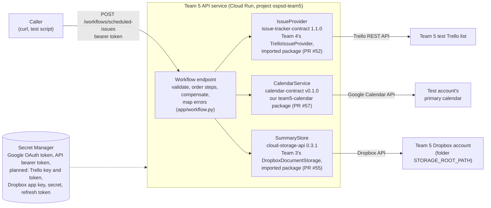

# Team 5: composing Calendar, issue tracker, and storage

| Item | Value |
| --- | --- |
| Status | **Draft for team and outside-team review.** Endpoint in [PR #53](https://github.com/juno-junhyuk-lee/OSPSD-Team-5/pull/53), issue adapter in [PR #52](https://github.com/juno-junhyuk-lee/OSPSD-Team-5/pull/52) (merged), Calendar selection in [PR #54](https://github.com/juno-junhyuk-lee/OSPSD-Team-5/pull/54) and the `team5-calendar` package in [PR #57](https://github.com/juno-junhyuk-lee/OSPSD-Team-5/pull/57) (both merged), Team 3's storage package in [PR #55](https://github.com/juno-junhyuk-lee/OSPSD-Team-5/pull/55); deployment not started. Behavior below describes those PRs as of 2026-11-16 (#55 at `2314595`). Per-vertical detail (arriving with #53 and #55) lives in [WORKFLOW.md](docs/WORKFLOW.md), [ISSUE_TRACKER_INTEGRATION.md](docs/ISSUE_TRACKER_INTEGRATION.md), [HW3_CALENDAR_HANDOFF.md](docs/HW3_CALENDAR_HANDOFF.md) and [HW3_STORAGE.md](docs/HW3_STORAGE.md); this document holds the combined design and links to them instead of repeating them. |
| Milestone | HW3 Milestone 1, "Compose the Services", due November 18, 2026, before class |
| Owner | Member 5 (Ka Pui) coordinates; each section names the member who owns the code |
| Previous design | HW2 shared Calendar adoption: [docs/HW2_DESIGN.md](docs/HW2_DESIGN.md) |

## Goal and scope

One API operation turns a task into a tracked, scheduled, documented piece of work. A caller sends a title and a time slot. The service creates an issue, books a calendar event with the same title, writes a Markdown summary that links both, stores the summary, and returns all three references in one result.

The handout requires fixed steps with no language model, our own implementation for our vertical (Calendar), another team's implementation for each of the other two, configuration-only implementation swapping, failures reported in our HW1 error model with the failed step, deployment through our HW2 pipeline, and one test account with credentials outside the repository.

Not in scope for this milestone: a language model, an interface, more than one user, or more than this one scenario. Milestone 2 extends this document with the product, interface, agent, and real-user security.

**Why this workflow.** Each step writes to a different vertical and depends on the one before it: the summary needs both IDs. That makes every partial failure the handout asks about reachable, and the result is easy to check directly in each provider.

**Which steps need judgment later.** Today the caller supplies the title and time slot. In Milestone 2 an agent can choose those (what to call the task, which free slot to book, what the summary says). Validation, write order, compensation and error reporting stay fixed code, because they protect provider state.

**If another team's service is unavailable.** The operation fails before or at that step with a documented error, and nothing is faked or replaced silently. For a longer outage we switch to another team's implementation through configuration (the same setting-based selection the issue tracker and Calendar use; storage has no selector yet) and tell the owning team.

## How the system fits together



All three verticals run inside one FastAPI application. Separate boxes are separate contract boundaries, not separate services.

| Vertical | Shared contract | Implementation | Selected by | Owner |
| --- | --- | --- | --- | --- |
| Calendar | `calendar-contract` tag `v0.1.0` (`db73e62`) | our `team5-calendar` package (the HW2 Google adapters, packaged in PR #57 and released as `team5-calendar-v0.1.0`; Teams 1 and 4 import the same package) | `CALENDAR_IMPLEMENTATION=google` (PR #54) | Member 2 (Jim) |
| Issue tracker | `issue-tracker-contract` tag `issue-tracker-contract-v1.1.0` (`18fb7ae`) | Team 4's `team-4-issue-tracker-trello` package, tag `team-4-issue-tracker-trello-v1.0.0` (`c88ce2f`), run in our process against our Trello list. Still Team 4's latest package tag on 2026-11-17: `team-4-trello-impl/` is unchanged on their `main` since `c88ce2f` | `ISSUE_TRACKER_IMPLEMENTATION=team4_trello` (PR #52) | Member 3 (Juno) |
| Cloud storage | `cloud-storage-api` tag `0.3.1` (`664afc9`; its package metadata says `0.2.0`) | Team 3's `dropbox-client-impl` and `cloud-storage-client-api` packages at commit `fde60d4` (no release tag yet), run in our process against Team 5's Dropbox account | nothing to select yet: `get_summary_store` always builds Team 3's package; settings `STORAGE_ROOT_PATH` and `DROPBOX_*` (PR #55) | Member 4 (Kristie) |
| Composition | none (our endpoint) | `app/workflow.py` | not configurable | Member 1 (Niriti) |

Credentials never enter the repository. Locally they come from git-ignored files and environment variables. In the deployment they come from Secret Manager through the HW2 Terraform configuration. The issue tracker needs our Trello key, token and list ID (`TRELLO_API_KEY`, `TRELLO_TOKEN`, `TRELLO_LIST_ID`), kept locally in ignored `.env.trello`. Storage needs Team 5's Dropbox app key and secret (`DROPBOX_APP_KEY`, `DROPBOX_APP_SECRET`) and a refresh token (`DROPBOX_REFRESH_TOKEN`, or an absolute path in `DROPBOX_TOKEN_FILE`), plus `STORAGE_ROOT_PATH` and `PYTHON_DOTENV_DISABLED=1`, because Team 3's package otherwise loads a `.env` file when imported. The Trello and Dropbox secrets are not in Secret Manager or the deployment yet (open question 5). They will follow the HW2 pattern: Terraform creates each secret without a value and gives Cloud Run access to it, and the value is added with `gcloud secrets versions add`. No secret value passes through Terraform variables, so none appears in Terraform state or deployment logs.

### A request traced end to end

```http
POST /workflows/scheduled-issues
Authorization: Bearer <from Secret Manager>
Content-Type: application/json

{"title": "Fix login bug", "start": "2030-01-07T15:00:00Z", "end": "2030-01-07T15:30:00Z"}
```

The `step` column is the value an error reports. IDs below are illustrative until the first deployed run replaces them with real output.

| `step` | Call | Intermediate state |
| --- | --- | --- |
| `validate` | none; checks the title against both contracts (issue: 1 to 256 characters with a non-space; Calendar: not blank) and the times against the Calendar contract's start/end rules | nothing written |
| `issue` | `IssueProvider.create_issue(title)` → Team 4's package → Trello (one attempt; timeout fixed by the package) | issue `T4-123` exists |
| `event` | `CalendarService.create(CreateEvent(title, start, end))` → Google | event `abc123` exists |
| `summary` | `render_summary(issue, event)` (pure function: Markdown from provider-confirmed values, titles escaped, IDs in code spans), then `SummaryStore.save_summary(name, markdown)` → Team 3's package → Dropbox (one upload, SDK retries off), then a download compared byte for byte | file `scheduled-issue-T4-123-abc123.md` exists and matches |

The summary name comes from the issue and event IDs (`summary_name` in `app/workflow.py`), so it is unique per attempt and can be found again from the IDs in `leftovers`.

Success is `201`:

```json
{
  "issue": {"id": "T4-123", "title": "Fix login bug"},
  "event": {"id": "abc123", "title": "Fix login bug", "start": "2030-01-07T15:00:00Z", "end": "2030-01-07T15:30:00Z"},
  "summary": {"id": "scheduled-issue-T4-123-abc123.md", "markdown": "# Fix login bug\n…"}
}
```

If storage definitely fails (for example, Dropbox denies permission), the service deletes the event, then the issue, and returns `502`:

```json
{
  "error": {
    "code": "provider_error",
    "message": "Summary storage failed.",
    "retryable": false,
    "step": "summary",
    "leftovers": []
  }
}
```

## Decisions with the largest effect

### 1. Depend only on the shared contracts; choose each implementation by a setting

- **Constraint:** we must use another team's implementation for two verticals, and swapping teams must need no code change.
- **Approach:** the endpoint depends only on contract types (`IssueProvider`, `CalendarService`, `SummaryStore` over `DocumentStorage`). A dependency factory reads a setting and returns the implementation. Both other-team verticals import the other team's package and run it in our process against our own provider account:
  - **Issue tracker:** Team 4's package against our Trello list (PR #52). This follows Tyler's November 15 clarification of the TA's expectation, and replaced an earlier HTTP adapter that could not pass `fresh=True` through Team 4's cached API.
  - **Storage:** Team 3's package against our Dropbox account (PR #55). It replaced an earlier HTTP adapter for Team 3's hosted service after Hari answered in the course help channel that a package dependency is required.
- **Alternative:** call each team's hosted service over HTTP. It keeps provider credentials with the other team, but the course does not count it as using their implementation, and Team 4's cached reads broke `fresh=True`.
- **Tradeoff:** we own the Trello and Dropbox credentials and inherit each package's behavior: Team 4's fixed timeout, and Team 3's `.env` loading on import, which we turn off. A swap now means a different package plus a setting that selects it, not just a URL. Storage has no such setting yet.
- **Revisit when:** Team 1's storage package satisfies the same contract; then storage gets a selector setting like the other two verticals (open question 2).

### 2. Never retry a write; undo only after a definite failure; report what may remain

- **Constraint:** the Calendar and issue-tracker contracts both report an uncertain write as a non-retryable `provider_error` and forbid retrying it; we apply the same rule to storage. No vertical gives us an idempotency key we have verified.
- **Approach:** each write runs once. If a later step *definitely* did nothing, earlier writes are deleted newest first (a `not_found` during cleanup counts as removed). If a write's outcome is *uncertain*, nothing is deleted. The error lists every resource that may still exist (`leftovers`, each `created` or `uncertain`). `retryable` is true only when the failed step allows a retry **and** nothing from this attempt remains.
- **Storage certainty (PR #55):** a storage failure counts as definite only for a typed rejection (name conflict, permission, invalid input or operation, size, not found) or a connection that could not be opened (connect timeout or new-connection failure, read from the exception's type chain, never its message). Anything else, and any failure after the upload was acknowledged, is uncertain. These rules depend on Team 3's pinned commit and must be rechecked when it or the Dropbox SDK changes.
- **Alternative:** retry with idempotency keys (Team 4's package has tagged-creation helpers we leave disabled), or a saga that records state and finishes later.
- **Tradeoff:** an uncertain failure needs a person to reconcile, guided by `leftovers`. In return, the workflow never automatically retries an uncertain write and never claims unfinished work succeeded. Resubmitting the whole request can still create another issue and event (see the retry case below).
- **Revisit when:** all three implementations offer idempotency we can verify across restarts.

### 3. One title for issue and event; the summary uses provider-confirmed values

- **Constraint:** the summary must link the real records, and the two contracts limit titles differently.
- **Approach:** validate the title against both contracts before any write, then render the summary only from values the providers returned.
- **Alternative:** separate issue and event titles, or render from the request.
- **Tradeoff:** a slightly stricter title rule. In return, the summary cannot disagree with the providers.
- **Revisit when:** the Milestone 2 product needs different titles.

### Boundaries and rules that must hold

- Input is validated once, in step 1, before any write. Contract-level validation inside adapters is a second guard, not the main one.
- Implementations are built in `app/workflow_dependencies.py` from settings. Trello and storage settings and the Calendar selector are checked during dependency resolution, so a missing one fails with `503` before any write. Google authorization has two cases. In the deployed (hosted) service, startup reads `CALENDAR_TOKEN_FILE` and checks its fields and scopes, so a missing or malformed credential file stops the service from starting, before any issue can be created. A revoked refresh token passes those local checks and is rejected by Google only at `step: event`, after the issue exists; the issue is then deleted, or listed in `leftovers` if cleanup fails. Ordinary access-token expiry is refreshed in memory automatically.
- Remote error messages are never forwarded. Messages are fixed text and logs are sanitized (HW1 Level 5 rules).
- Even when a dependency fails: no write is retried, no uncertain write is undone, and `retryable` is never true while anything from the attempt may remain.

### Operations we need beyond the shared contracts

| Need | Calendar | Issue tracker | Storage |
| --- | --- | --- | --- |
| Create | `create` | `create_issue` | `save_summary` (our `SummaryStore` protocol) |
| Delete, for compensation | `delete` | `delete_issue` | not needed: storage is the last step |
| Find, to reconcile an uncertain write | by ID only | by ID only (`get_issue(fresh=True)` reads Trello directly) | the error gives the known path in the summary leftover's `path` (its `id` stays `null`); `SummaryStore` exposes only `save_summary`, so reconciliation is manual today |
| Verify a write | not done | not done | every summary is downloaded and compared byte for byte before success (PR #55) |

### Mismatches with other teams' implementations

| Date found | Team | Mismatch | Effect | Reported |
| --- | --- | --- | --- | --- |
| 2026-11-12 | Team 4 | The contract's `get_issue(fresh=True)` could not be expressed over Team 4's HTTP API, whose reads were cached for 30 s | Resolved on 2026-11-15 by importing Team 4's package, which has no cache | Not needed after the switch |

## What could go wrong

| Failure | Trigger | State left behind | Caller sees | Recovery | Test |
| --- | --- | --- | --- | --- | --- |
| Invalid input | Blank title, `end` before `start` (`422`), or malformed or empty JSON (`400`) | nothing | `422` or `400`, `step: validate`, `retryable: false`. Open: with Trello unconfigured, it returns `503` `step: issue` instead (see below) | fix the request | `tests/test_workflow.py` |
| Trello token rejected | Expired or revoked key or token (Trello `401`/`403`, which Team 4's package reports as `ACCESS_DENIED`) | nothing | `403`, `step: issue`, `retryable: false` | replace the token in Secret Manager | controlled fake |
| Trello fails | Outage, rate limit, list removed, or another definite rejection | nothing | `502`, `step: issue`, `retryable: false` | retry later, or fix the list | controlled fake |
| Issue response lost | Timeout after send | issue may exist | `502`, `step: issue`, leftover issue `uncertain`, `retryable: false` | check Trello by title before retrying | controlled fake |
| Google credential file unusable | Deployed service: `CALENDAR_TOKEN_FILE` missing, malformed, or without the required scopes | nothing (the service does not start) | no response; the revision fails to start | fix the secret, then redeploy | `tests/test_hosted_runtime.py` |
| Google token revoked | Refresh token revoked or expired; Google rejects it at the event step (ordinary access-token expiry is refreshed automatically) | issue deleted by compensation, or listed in `leftovers` if cleanup fails | `503` `provider_unavailable`, `step: event`, `retryable: false` | run `scripts/google_calendar_auth.py`, update the secret | HW2 Level 5 auth-failure test, plus workflow fake |
| Event response lost | Timeout after Google receives the insert | issue exists, event may exist | `502`, `step: event`, leftovers issue `created`, event `uncertain`, `retryable: false` | find the event by title and time in Google Calendar; delete both by hand or keep both. Two events with the same title and time cannot be told apart, because the shared Calendar contract has no field for a request ID (open question 7) | controlled fake |
| Storage rejects the summary | Team 3's package reports a definite rejection (name conflict, permission, invalid input or operation, size, not found), or the connection to Dropbox could not be opened | event then issue deleted | `502`, `step: summary`, `leftovers: []`, `retryable: false` | fix the cause, then send a new request | controlled: injected Dropbox SDK failures through Team 3's real error translation (PR #55) |
| Storage misconfigured | Missing or invalid `STORAGE_ROOT_PATH` or Dropbox credentials, or `PYTHON_DOTENV_DISABLED` not `1` | nothing (checked before the issue is created) | `503`, `step: summary`, `leftovers: []` | fix configuration | `tests/test_storage_package.py`, `tests/test_workflow.py` (PR #55) |
| Storage response lost or unverified | Read timeout, lost reply, unrecognized error, any failure after the upload was acknowledged, or downloaded bytes differ | issue and event exist, summary may exist | `502`, `step: summary`, leftovers issue+event `created`, summary `uncertain` with its `path`, `retryable: false` | look for the file at that path in Team 5's Dropbox; finish or delete by hand | controlled, as above |
| Compensation fails | Delete call fails after a definite failure | records that could not be deleted | original error, with those records in `leftovers` | delete by hand using the IDs | controlled fake |
| Service stops mid-request | Instance restart or request timeout between steps | earlier writes, with no record on our side | connection error, no body | find records by title in each provider; accepted risk for one test account | none; documented limit |
| Missing or wrong bearer token | Caller omits the token, or sends a wrong one (deployed service) | nothing | `401` in the shared three-field shape (`code`, `message`, `retryable`), without `step` or `leftovers`, because authentication runs before the workflow | send the right token | `tests/test_hosted_runtime.py` (not workflow-specific) |
| Same request sent twice | Client resends after a timeout | two issues and two events | two successful results | delete the duplicate by hand; accepted risk until idempotency (open question 3) | none; documented limit |
| Issue tracker or Calendar not configured | Missing `TRELLO_*` setting, or `CALENDAR_IMPLEMENTATION` not `google` | nothing | `503` before any write, `step: issue` or `step: event`, `leftovers: []` | fix configuration | dependency test |

**The handout's retry case** (event created, summary save fails, caller retries): after a *definite* storage failure, the event and issue are deleted and `leftovers` is empty, so a retry cannot duplicate anything; `retryable` is still false, because PR #55's store reports every definite storage failure as non-retryable (a name conflict, for example, would fail again). After an *uncertain* storage failure, both records stay, `retryable` is false, and the caller gets their IDs and the summary's path. The caller should not resend the request: a new request creates a new issue and event, so the service cannot recognize it as a retry. A safe automatic retry needs the caller to send an idempotency key that the service stores with the IDs, plus a storage read to check for the summary; both are open question 3.

**Error shape:** every error from the endpoint carries `step` and `leftovers`, including request validation (`400`/`422`, `step: validate`) and the configuration `503`s. Niriti fixed this in PR #53 (`70f9286`, 2026-11-17) after Jim's review; the full suite passes at that commit (808 passed, 58 skipped). Two exceptions remain. Authentication failures keep the shared three-field `401`, as documented in the failure table. Open, from Juno's review of #53: provider settings are checked before request validation, so with Trello unconfigured, a request missing `end` or an empty body returns `503` `step: issue` instead of `422` or `400` `step: validate`. The existing validation tests replace the workflow dependency and miss this. Niriti to fix, with a regression test that uses the real route wiring.

## Verification plan

| Check | Kind | Evidence |
| --- | --- | --- |
| Step order, Markdown, compensation, error mapping | Controlled: fakes for all three contracts | `tests/test_workflow.py` in CI on the submitted commit |
| Each adapter against its contract | Controlled | `tests/` for PRs #52, #54, #55 and #57; #52 and #55 also have live probe records (Trello; Team 3's package against Team 5's Dropbox) |
| Full workflow, run locally | Real providers, test account | done 2026-11-16 at `e2616dd` (PR #55, [WORKFLOW.md](docs/WORKFLOW.md#local-real-provider-workflow-evidence)): `201`, then a fresh issue read, a Calendar read, exact summary bytes, and cleanup confirmed absent. Read by our own scripts; nobody has yet checked the records in the provider web pages |
| Full workflow through the **deployed** endpoint | Real providers, test account | response body; the issue seen in Trello, the event in Google Calendar, the file in Team 5's Dropbox, each checked directly, not through our API |
| Swap storage from Team 3 to Team 1 | Real, configuration only | the deployment diff shows only a setting change; the same workflow run with the file found in Team 1 storage. Blocked: Team 1's package has namespace, metadata and interface gaps, and no storage selector exists yet |
| Controlled failure | The handout's case (event created, summary save fails) against real Trello and Google: a failing storage implementation, selected by configuration in a separate `verify` deployment (never the `demo` one); needs the storage selector that does not exist yet | the caller receives the documented error with `step: summary`, and compensation is confirmed in the providers: the issue and event are gone from Trello and Google |
| Cleanup | Real | all test records deleted, confirmed by direct provider reads |

Success means observable provider records plus the documented API result, never our own logs alone. Each record is checked in its provider: Trello, Google Calendar, and Team 5's Dropbox folder, viewed in Dropbox itself rather than through Team 3's package.

## Open questions

1. ~~Does calling Team 3's hosted storage service count as using their implementation?~~ Resolved 2026-11-16: Hari said in the course help channel that a package dependency is required, so PR #55 imports Team 3's package.
2. How does storage swap to Team 1? Team 1's package has namespace, metadata and interface gaps, and we have no storage selector yet. (Member 4, with Team 1)
3. Should callers send an idempotency key, and should the storage adapter read before writing, so a retry after an uncertain write becomes safe?
4. Does the controlled failure need to run on the deployed service, or is a local run with a failing implementation enough? (ask staff)
5. Who runs the deployment through the HW2 pipeline, and which settings and secrets does the workflow add (`TRELLO_*`, `STORAGE_ROOT_PATH`, `DROPBOX_*`, `PYTHON_DOTENV_DISABLED`; the Terraform service does not wire them yet)? (Member 1 owns deployment per PR #52 and #55)
6. ~~How does the deployed service keep the Google token fresh?~~ Answered 2026-11-17 by Jim for the implementation: the workflow uses `get_calendar_service`, so the hosted behavior applies (startup checks, then in-memory refresh that never writes back to the mounted secret). The deployed workflow check is still pending.
7. Should each event carry a request ID so an operator can find it after an uncertain write? The shared Calendar contract has only `title`, `start` and `end`. Options: add the issue ID to the event title (changes decision 3), or propose an optional field in `calendar-contract` that the Google adapter stores as a private extended property (needs Teams 2 and 7). Raised by Team 4; not planned for Milestone 1. (Member 2)

## How to call it

Filled in after deployment: the endpoint URL, how a grader obtains the bearer token, one `curl` example, and how to delete the records a run creates.

## Review record

The handout requires review within the team and by another team before submission, with questions and responses recorded here.

| Date | Reviewer | Question or comment | Response or change |
| --- | --- | --- | --- |
| 2026-11-14 | Jim (Team 5) | `422` and `503` errors lack `step` and `leftovers` (PR #53) | Fixed by Niriti in PR #53 (`70f9286`, 2026-11-17): validation returns `step: validate`, configuration errors name their step, all with `leftovers: []` |
| 2026-11-15 | Ka Pui (Team 5) | A refused connection to storage was reported as uncertain, so the issue and event were kept although nothing was written (PR #55) | Implemented in PR #55, review pending: a connect timeout or new-connection failure, read from the exception's type chain, now counts as definite and triggers cleanup; other connection errors stay uncertain |
| 2026-11-16 | Juno (Team 5) | A rejected Trello token returns `403` (`ACCESS_DENIED` from Team 4's package), not `502`/`503`; separate it from configuration and outage failures | Split into "Trello token rejected" (`403`) and "Trello fails" (`502`); missing configuration stays `503`. Checked against Team 4's `provider.py` and `_issue_failure` in PR #53 |
| 2026-11-16 | Juno (Team 5) | Use #57's stable Calendar contract and package details | Calendar now cites `calendar-contract` `v0.1.0` and the `team5-calendar` package (PR #57) |
| 2026-11-16 | Juno (Team 5) | Update the storage architecture once its approach is settled | Storage now imports Team 3's package (Hari's clarification). Diagram, settings, credentials, failure rules, verification and open questions updated from Kristie's handoff in PR #55 |
| 2026-11-16 | Kristie (Team 5) | Seven storage changes from #55's handoff (`docs/HW3_STORAGE_REVIEW_HANDOFF.md`): package path and pins, Dropbox settings, Hari's answer, failure certainty, local evidence, lazy Google authorization | All seven made in this revision. #53's validation and configuration error shape stays open (Jim's row) |
| 2026-11-17 | Jim (Team 5) | Separate a missing or malformed hosted credential file (service does not start) from a revoked refresh token (rejected at the event step); replace "never creates duplicates" with "never automatically retries an uncertain write"; answered open question 6 | Both changes made: the dependency-resolution rule and the failure table now list the two Google cases, and decision 2 uses the new wording. Open question 6 marked answered; deployed check still pending |
| 2026-11-17 | Juno (Team 5) | With Trello unconfigured, invalid input returns `503` `step: issue` instead of `422`/`400` `step: validate`, because provider settings are checked first; document the shared `401` separately (PR #53) | Recorded under "Error shape" and in the failure table (new `401` row). Open: Niriti to validate the request before checking provider settings, with a regression test through the real route |
| 2026-11-17 | Turki (Team 4) | Use the latest version of Team 4's package | We pin `team-4-trello-impl` at `team-4-issue-tracker-trello-v1.0.0` (`c88ce2f`); it is still their latest package tag, and the package folder is unchanged on their `main` since then |
| 2026-11-17 | Turki (Team 4) | Keep the Trello and Dropbox credentials in Secret Manager and pass them through Cloud Run's secret integration, not as Terraform variables, so they never reach Terraform state or logs | Adopted: the credentials section now commits to the HW2 pattern (Terraform creates the secret without a value; the value is added with `gcloud`). Wiring stays open question 5 |
| 2026-11-17 | Turki (Team 4) | Finding an uncertain event by title and time is ambiguous when events share both; attach a request ID to the event | Recorded as a limitation in "Event response lost" and as open question 7: the shared Calendar contract has no field for it, so the fix needs a title change or a contract change |
| 2026-11-17 | Turki (Team 4) | Verify compensation against real providers, especially an event created and then a failed summary save | Planned as the "Controlled failure" check, now stated as that case with deletion confirmed in Trello and Google |
