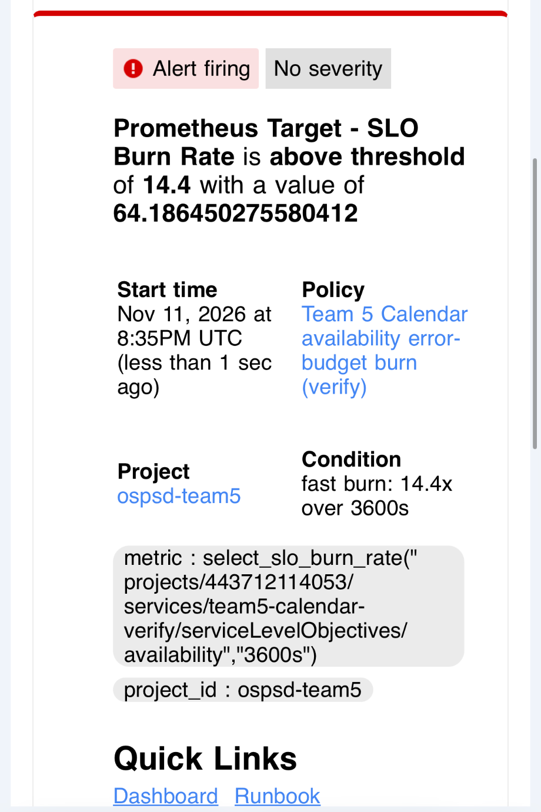

# Level 4 SLIs, SLOs, error budget and alerts

Owner: Ka Pui Cheung. Built on the [Level 3 metric reference](OBSERVABILITY_HANDOFF.md#level-4-metric-reference). Terraform: `infra/observability/slo.tf`.

## Scope

- Operations: the four shared-contract operations `create`, `get`, `replace`, `delete`. PATCH, calendar metadata, `health`, `ready` and `http_other` are excluded.
- Environment: `demo` by default (`slo_environment`). `verify` is disposable and never shares an objective with `demo`.
- Releases are aggregated within the environment; a deploy does not reset the budget.

## SLIs and objectives (28-day rolling window)

| SLO | SLI (request-based) | Objective | Budget |
| --- | --- | --- | --- |
| Availability | Eligible = all shared-operation requests (`calendar.requests`). Bad = errors with `failure_source` `service` or `provider` (`calendar.request.errors`). | 99% | 1% of requests |
| Latency | Eligible = successful shared-operation requests (`calendar.request.duration`, `outcome="success"`). Good = finished within 1 s. | 95% | 5% of successful requests |

Why these choices:

- Caller outcomes (`invalid_input`, `not_found`, `access_denied`) are correct rejections, so they count as eligible but never as bad. A 404 is not an outage.
- Provider failures count as bad: users see a failed request whatever the cause, and Google outages are the main availability risk.
- Latency uses success only, so fast rejections cannot hide slow successes. The Level 3 sample shows create at 538 ms (Google insert 516 ms) and rejections at about 4 ms; 1 s leaves room for Google calls but flags cold starts and slow provider calls.
- Histogram buckets bound the threshold; 1 s must stay a bucket boundary.

## Calculating the current value

Both SLIs are ratios of request counts over the 28-day window:

- Availability = (eligible − bad) / eligible, where eligible is the increase of `calendar.requests` and bad is the increase of `calendar.request.errors` with `failure_source` `service` or `provider`.
- Latency = successful requests in the `le="1"` histogram bucket / all successful requests.
- Error budget left = 1 − (bad / eligible) / (1 − objective). Burn rate over a window = (bad / eligible in that window) / (1 − objective).

The exact Cloud Monitoring filters are in `infra/observability/slo.tf` (`total_service_filter`, `bad_service_filter`, `distribution_filter`). To reproduce the numbers Cloud Monitoring computes, ask the SLO itself (any signed-in project viewer; adjust the dates):

```sh
SLO=projects/ospsd-team5/services/team5-calendar-demo/serviceLevelObjectives/availability  # or .../latency
for SELECTOR in select_slo_counts select_slo_compliance select_slo_budget_fraction; do
  curl -sG https://monitoring.googleapis.com/v3/projects/ospsd-team5/timeSeries \
    -H "Authorization: Bearer $(gcloud auth print-access-token)" \
    --data-urlencode "filter=$SELECTOR(\"$SLO\")" \
    --data-urlencode interval.startTime=2026-10-14T00:00:00Z \
    --data-urlencode interval.endTime=2026-11-11T00:00:00Z \
    --data-urlencode aggregation.alignmentPeriod=2419200s \
    --data-urlencode aggregation.perSeriesAligner=ALIGN_SUM
done
```

`select_slo_counts` returns good and bad series; `select_slo_compliance` and `select_slo_budget_fraction` return the ratio and the budget left. The same values are on the Monitoring SLO page for the `Team 5 Calendar (demo)` service.

### Recorded value

Read back on 2026-11-08 at 19:13 EST over the previous 6 h: availability 7 good / 0 bad, so 7 / 7 = 100% against 99%, budget left 1.0. Latency 5 good / 0 bad successful requests, so 5 / 5 = 100% against 95%, budget left 1.0.

### Error-budget examples

| Case | Availability (99%) | Latency (95%) |
| --- | --- | --- |
| Budget for 10,000 eligible requests in 28 days | 100 service/provider failures | 500 successes slower than 1 s (of 10,000 successes) |
| 40 bad of 10,000 | SLI 99.6%; budget used 40 / 100 = 40%, left 60% | 200 slow: SLI 98.0%; used 40%, left 60% |
| 80 bad of 10,000 | SLI 99.2%; used 80%, left 20%: feature freeze (policy below) | 400 slow: SLI 96.0%; used 80%, left 20%: freeze |
| 120 bad of 10,000 | SLI 98.8%; budget exhausted (−20%): roll back | 600 slow: SLI 94.0%; exhausted: roll back |

Burn-rate examples for availability: in one hour with 100 eligible requests, 15 bad gives a 15% error ratio and a burn rate of 0.15 / 0.01 = 15 > 14.4, so the fast condition opens. At that rate the 28-day budget lasts 28 × 24 / 15 ≈ 45 h. One bad request in 100 is a burn rate of 1.0, which spends the budget exactly over 28 days and alerts on neither window.

## Alerts

One policy per SLO, each with two burn-rate conditions (Google SRE multiwindow pattern):

| Condition | Window | Burn rate | Meaning |
| --- | --- | --- | --- |
| Fast | 1 h | > 14.4 | About 2% of the 28-day budget in one hour; act now |
| Slow | 6 h, held 5 min | > 6 | About 5% of the budget in six hours; act the same day |

`alert_email` adds an email channel; it is empty by default so applying the module emails no one by surprise. Both `demo` and `verify` are applied with `alert_email=kc5931@nyu.edu`, so each environment's policies notify its own channel, "Team 5 Calendar SLO alerts (demo)" or "(verify)". Each alert's documentation links to the [dashboard](https://console.cloud.google.com/monitoring/dashboards/custom/c25e66c8-e3e3-44bc-af2b-6707ca37a175?project=ospsd-team5) and to the runbook below, both in its Markdown body and as incident links.

## Runbook

1. Open the dashboard from the alert. Check the traffic panel first: no traffic means no data, not health.
2. Find the operation with errors and read its outcome and source. `provider` points at Google Calendar; `service` points at our code or configuration.
3. Open the [outcome logs](https://console.cloud.google.com/logs/query?project=ospsd-team5) for that operation and follow a trace ID into Cloud Trace to see which Google call failed or was slow.
4. If a deploy started it, roll back to the last verified revision through the Deploy workflow's `rollback_run_id` input ([deployment runbook](DEPLOYMENT.md#level-2-automated-deployment-and-recovery)), then run the smoke test.
5. If Google is failing, do not retry uncertain POST/PUT requests (`retryable=false`); wait for recovery and watch the burn rate fall.
6. When the incident closes, record the budget left and apply the error-budget policy below.

## No data, resets and retries

- These SLIs are measured inside the service, so they cannot see requests that never reach it: DNS or TLS failures, Cloud Run front-end errors, cold-start timeouts at the load balancer, or a service that is down entirely. Those show up as missing traffic, not as bad requests; an uptime check or client-side probe would be needed to count them.
- No data is not zero errors. A missing series can mean no traffic, too few samples or broken telemetry. Burn-rate conditions evaluate to no data in that case; check the dashboard's traffic panel before trusting a quiet alert.
- Counters are cumulative per process; Cloud Monitoring's SLO computation handles resets per time series, so do not pre-sum counters across instances.
- Uncertain POST/PUT results keep `retryable=false`. An alert never authorizes retrying them.
- A wrong 2xx response is still "good" to these SLIs. Conformance tests and provider read-back remain the correctness checks.

## Error-budget policy

| Budget left (28 d) | Action |
| --- | --- |
| > 50% | Normal work; deploy through the existing pipeline. |
| 25–50% | Each deploy needs a passing Google smoke run before traffic moves; review the failing outcome/source on the dashboard. |
| < 25% | Freeze feature merges to `hw2/milestone-3`; only reliability fixes and rollbacks until the budget is above 25%. |
| Exhausted | Roll back to the last verified release; write a short incident note in the PR that caused it. |

Provider-caused burn still counts. If Google is the cause, the response is retry/backoff or capacity work on our side, not excluding the data.

## Verification

| Check | Status |
| --- | --- |
| `terraform test` (mock provider): goals, bad-filter scope, success-only latency, two burn conditions per SLO, no default channel | Added in `tests/slo.tftest.hcl` |
| Apply in `ospsd-team5` and confirm both SLOs report compliance on the demo service | Done 2026-11-08 19:11 EST: 5 resources added, nothing changed or destroyed. Read-back at 19:13 over the previous 6 h: availability 7 good / 0 bad, latency 5 good / 0 bad; compliance 1.0 and budget left 1.0 for both. Both alert policies enabled with 1 h and 6 h `select_slo_burn_rate` conditions. |
| Alert links on `demo` | Applied 2026-11-11 15:30 EST: both policies updated in place (0 added, 2 changed) with the Dashboard and Runbook links. |
| Notification destination on `demo` | Applied 2026-11-11 15:59 EST with `alert_email=kc5931@nyu.edu`: channel "Team 5 Calendar SLO alerts (demo)" added and attached to both `demo` policies (1 added, 2 changed). |
| Alert test: inject provider failures in `verify`, confirm the alert reaches a real destination and resolves after recovery | Done 2026-11-11, details below. Fired 15:35:25 EST, email received, closed 15:38:20 EST. |

### Alert test (2026-11-11)

The `verify` SLOs and alerts were applied with `slo_environment=verify` and `alert_email=kc5931@nyu.edu` under their own state prefix (`calendar/observability-verify`), then provider failures were injected (Google Calendar calls failing TLS, so requests returned `provider_unavailable`).

| Time (EST) | Event |
| --- | --- |
| 15:32:58–15:34:21 | Failure injection: 43 provider failures, 5 good requests. |
| 15:35:25 | Alert opened: "Team 5 Calendar availability error-budget burn (verify)", fast burn 64.19x. Email delivered to kc5931@nyu.edu with Dashboard and Runbook links. |
| 15:35:59 | Recovery: failures stopped, normal traffic resumed. |
| 15:38:20 | Alert closed; 1 h burn rate back to 6.07 (below 14.4). |

- Incident: [`0.oewehvv3uzw4`](https://console.cloud.google.com/monitoring/alerting/incidents/0.oewehvv3uzw4?project=ospsd-team5) (API name `projects/ospsd-team5/alerts/0.oewehvv3uzw4`, policy `alertPolicies/14475636449240691308`), opened 20:35:25 UTC, closed 20:38:20 UTC.
- Notification: email channel `notificationChannels/10564378853256895788` to kc5931@nyu.edu. The firing email below shows the policy, condition, burn value and the Dashboard and Runbook links.


